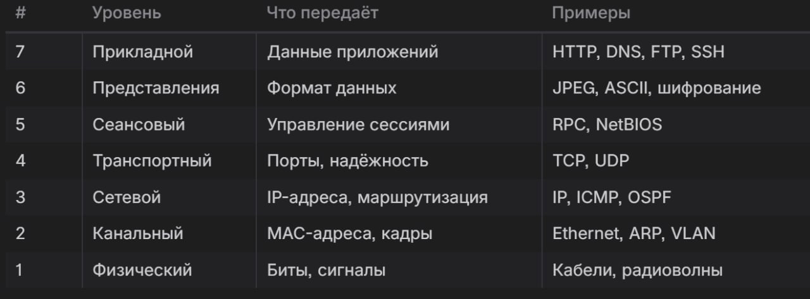

# День 2. Модель OSI: 7 уровней сетевого взаимодействия

> **Тут вообще нет ничего сложного, просто представь, что ты отправляешь своему дружбанчику сообщение в тг, нажал кнопку "Отправить" сообщение дошло. Но что вообще произошло между этими моментами??** Тут как раз таки и появляется модель OSI

---

## Что такое модель OSI?

**OSI** - это **эталонная** модель, которая описывает, как устройства взаимодействуют и обмениваются данными между собой в сети

Тут важно понять, что модель именно **ЭТАЛОННАЯ**, она не используется в сети, она просто показывает, как работает общение между устройствами

---

Она делится на 7 уровней, у каждого из которых есть свои обязанности:

### 1) Физический уровень

Самый приземленный уровень в буквальном смысле. Это кабели, радиоволны, электрические сигналы - короче все то, что можно потрогать или хотя бы увидеть

**Его задача**: превратить биты(нолики и единицы) в сигнал и передать его физически

**Примеры**: Ethernet-кабель, Wi-Fi, оптоволокно, Bluetooth

### 2) Канальный уровень

Здесь биты превращаются в **кадры (frames)** и впервые появляется адресация - но не IP, а **MAC-адрес**. Это уровень «соседей»: устройства в одной локальной сети напрямую разговаривают друг с другом

**Его задача**: доставить данные между двумя устройствами в пределах одного сегмента сети, обнаружить ошибки передачи

**Примеры:** Ethernet, Wi-Fi (802.11), коммутаторы (свитчи) работают

### 3) Сетевой уровень

Вот тут уже появляется ip-адреса и начинается магия - маршрутизация. Данные теперь называются пакетами

**Его задача**: найти путь от вашего устройства до сервера, где бы он не был бы

### 4) Транспортный уровень

Это уровень, который отвечает за передачу данных между приложениями. TCP обеспечивает надёжную и упорядоченную доставку, а UDP не гарантирует доставку и порядок получения данных. Данные превращаются в сегменты

**Его задача**: обеспечить доставку между приложениями, разбить их на части и собрать их обратно

**Примеры:** TCP (надёжная доставка), UDP (передача без гарантий доставки и порядка)

### 5) Сеансовый уровень

Отвечает за то, чтобы соединение между двумя устройствами открывалось и корректно закрывалось, пока идет обмен данными

Его задача: управление сеансом связи, то есть установка, поддержание, завершение

### 6) Уровень представления

Короче уровень-переводчик. Данные могут быть зашифрованы, сжаты, ну или вообще в разных форматах, этот уровень приводит все к единому виду

**Задача:** преобразование форматов, шифрование, сжатие данных

**Примеры**: ASCII, JPEG, ASN.1. TLS часто условно относят к этому уровню

### 7) Прикладной уровень

До прочтения этого поста, вы могли бы даже не узнать, что именно с этим уровнем вы взаимодействуете почти каждый день. То есть тг, браузер, почта - все это прикладной уровень

**Задача:** предоставить интерфейс между пользователем/приложением и сетью

**Примеры:** HTTP/HTTPS, DNS, SMTP, FTP

---

> **Хотелось бы подметить, что при ОТПРАВКЕ данных они идут с прикладного уровня до физического, а при ПОЛУЧЕНИИ данных, наоборот с физического до прикладного**

## Шпаргалка по уровням OSI

---

[К оглавлению](../README.md) | ← [День 1](day-01-what-is-a-network.md) | [День 3](day-03-tcp-ip-model.md) →
