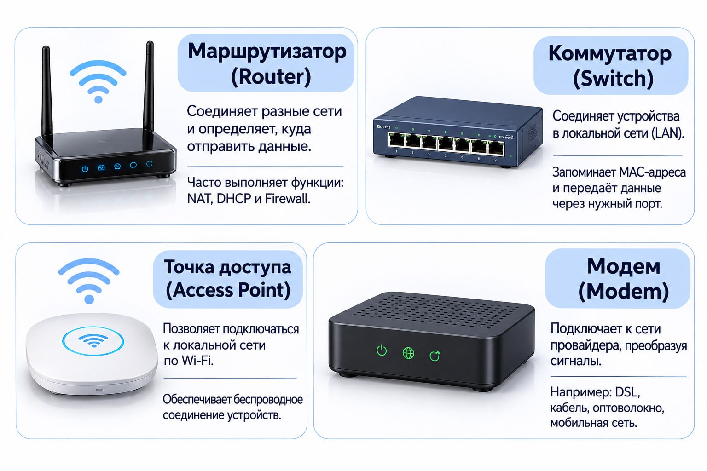

# День 4. Сетевое оборудование: кто за что отвечает в вашей сети?

**В прошлом посте мы разобрали модель TCP/IP и то, как данные путешествуют по сети. Сегодня поговорим о том, благодаря чему вообще работает вся эта система - о сетевом оборудовании**

> **Когда вы подключаетесь к Wi-Fi, открываете сайт или отправляете кому-то сообщение, за всем этим стоит несколько устройств, которые выполняют совершенно разные задачи**

---

## Зачем вообще нужно сетевое оборудование?

Представьте, что у вас дома есть комп, телефон, ноутбук. Все они хотят подключиться к интернету и обмениваться данными

Но как им взаимодействовать друг с другом? Как понять, куда отправить данные? Как подключить сразу несколько устройств к одной сети? ЕСЛИ НИЧЕГООО НЕПОНЯТНА?

Вот для этого и существует **сетевое оборудование**. Каждое устройство выполняет свою определённую функцию

---

## 1. Маршрутизатор (Router)

> **Маршрутизатор - это устройство, которое соединяет разные сети и определяет, куда дальше отправить пакет данных**

Например, вы открываете сайт с телефона. Ваш запрос должен попасть из домашней сети в интернет. Именно маршрутизатор помогает передать его в нужном направлении.

**Нооо это ещё не всё 🔐**

Домашние маршрутизаторы часто выполняют сразу несколько функций:

- **Маршрутизация** - выбор пути для передачи пакетов между сетями.
- **NAT** - преобразование частных IP-адресов в публичный адрес при выходе в интернет.
- **DHCP** - автоматическая выдача IP-адресов устройствам.
- **Firewall** - фильтрация сетевого трафика по заданным правилам.

> **То есть ваш домашний роутер - это не просто коробочка, которая раздаёт Wi-Fi, а довольно многофункциональное устройство**

---

## 2. Коммутатор (Switch)

> **Коммутатор - это устройство, которое соединяет несколько устройств внутри одной локальной сети (LAN) (про LAN уже говорил в 1 день обучения с нуля 😊)**

Представим офис, в котором находятся 20 компьютеров. Подключить каждый компьютер напрямую к маршрутизатору не всегда удобно. Поэтому используют коммутатор. Он позволяет объединить все эти устройства в одну локальную сеть

## Но как коммутатор понимает, кому отправить данные?

Для этого он использует **MAC-адреса**

Коммутатор изучает MAC-адреса подключённых устройств и формирует специальную таблицу, в которой хранит соответствие MAC-адресов и портов

> **Когда ему приходит кадр, он смотрит на MAC-адрес получателя и отправляет данные через нужный порт**

---

## 3. Точка доступа (Access Point)

> **Точка доступа — это устройство, которое позволяет беспроводным устройствам подключаться к локальной сети через Wi-Fi**

Например, в офисе есть локальная сеть, в которую подключены компьютеры через кабели. Но сотрудникам также нужно подключать телефоны и ноутбуки без проводов

Для этого устанавливают точку доступа.

Она создаёт беспроводную сеть, к которой могут подключаться устройства, а затем передаёт их трафик в проводную сеть **(ну я думаю, эта подтема из всех самая легкая)**

**Кстати, не путайте точку доступа с маршрутизатором**

Её основная задача - обеспечить беспроводное подключение, а не то, чтобы выполнять маршрутизацию

**А ещё:** в обычных домашних роутерах точка доступа уже встроена, поэтому вы можете пользоваться Wi-Fi без покупки отдельного устройства

---

## 4. Модем (Modem)

> **Модем - это устройство, которое обеспечивает подключение к сети провайдера, преобразуя сигналы в соответствии с используемой технологией связи**

Название происходит от двух слов: модулятор и демодулятор

Звучит сложно, но идея довольно простая: модем преобразует данные в сигналы, подходящие для передачи по определённой среде связи, и обратно

Например, провайдер может предоставлять интернет через:

- Кабельную сеть
- Оптоволоконную линию
- Мобильную сеть

> **Важно: модем и маршрутизатор - не одно и то же. Модем обеспечивает подключение к сети провайдера, а маршрутизатор передаёт данные между сетями. Иногда эти функции объединены в одном устройстве**

---

## Подготовил специально для вас небольшую табличку сравнение

| Устройство | Основная задача |
|---|---|
| **Маршрутизатор** | Передача пакетов между разными сетями |
| **Коммутатор** | Соединение устройств в локальной сети |
| **Точка доступа** | Подключение устройств по Wi-Fi |
| **Модем** | Обеспечение связи с сетью провайдера |

---

## Как всё это работает вместе?

Таааак, возьмем например обычную домашнюю сеть

У вас есть ноутбук, телефон и комп. Все они подключены к одному домашнему роутеру

1. **Модем** обеспечивает подключение к сети вашего интернет-провайдера
2. **Маршрутизатор** получает данные и определяет, куда их нужно отправить. Например, в интернет или другому устройству в локальной сети
3. **Коммутатор** соединяет устройства по кабелю и передаёт кадры нужным получателям
4. **Точка доступа** позволяет телефону и ноутбуку подключаться к сети по Wi-Fi

> **Таааак, сегодня разобрали сразу четыре важных устройства, которые вы будете постоянно встречать при изучении сетей и кибербезопасности**

## Как выглядит сетевое оборудование

---

[К оглавлению](../README.md) | ← [День 3](day-03-tcp-ip-model.md) | [День 5](day-05-mac-and-ip-addresses.md) →
